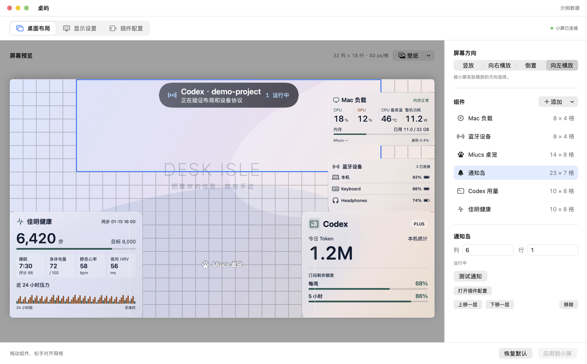
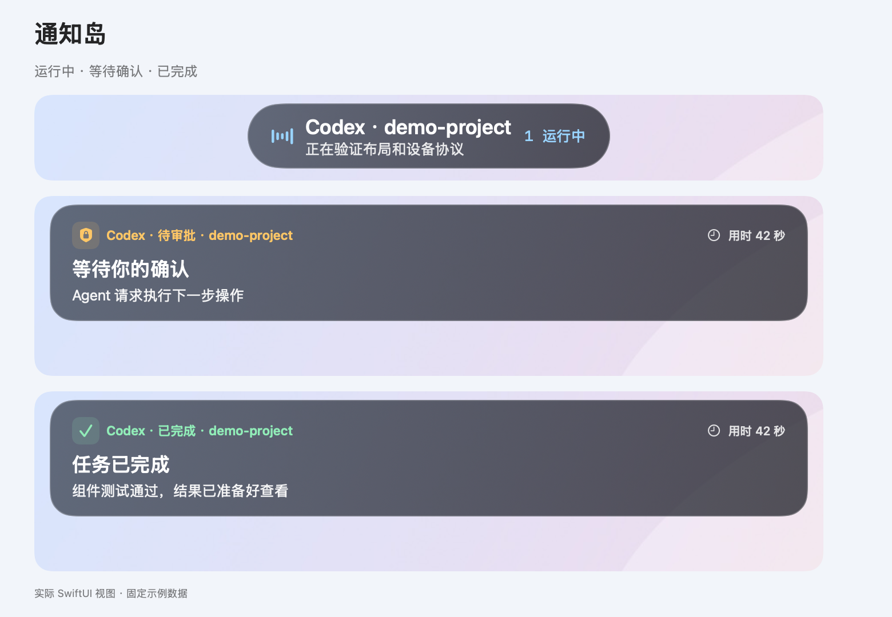
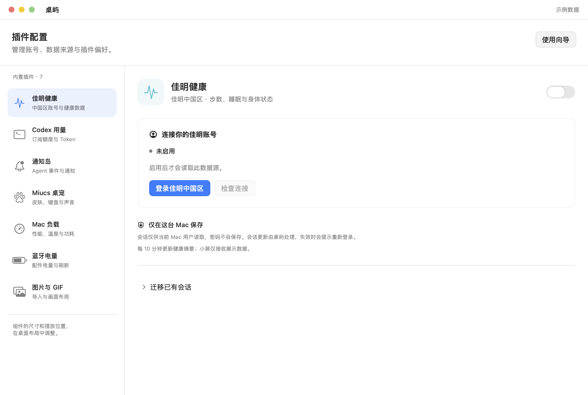

<div align="center">

# 桌屿 · DeskIsle

**把桌宠、Agent 通知和常用数据，放到桌边的一块小屏上。**

macOS 配置 · 40 px 网格布局 · ESP32-P4 板端绘制 · 一根 USB 线

[](#快速开始)
[](#硬件)
[](LICENSE)

[预览](#预览) · [组件](#组件) · [硬件](#硬件) · [快速开始](#快速开始) · [开发文档](docs/development.md)

</div>

## 预览



在 Mac 上拖动组件、切换预设尺寸和屏幕方向，然后应用到小屏。每格 **40 × 40 像素**，组件松手后吸附网格。

<details>
<summary><strong>查看通知岛的三种状态</strong></summary>



通过 Codex Hooks、本地命令或 JSON 事件接入。显示任务摘要、运行状态和待处理提醒；确认与回复仍在 Agent 应用中完成。

</details>

<details>
<summary><strong>查看插件配置</strong></summary>



账号和数据源按需启用；佳明会话由桌屿在本机保管，Codex 使用用户已有登录。

</details>

*预览由实际 SwiftUI 视图离线渲染，使用固定示例数据与原创渐变背景；不是实物拍摄。桌宠在布局编辑器中显示占位，动画在小屏上运行。[预览来源与重新生成](docs/images/README.md)*

## 能做什么

- **多套布局**：独立布局库保存组件、方向、壁纸、图片和桌宠皮肤；自动保存到 Mac，点击卡片切换小屏。
- **我的资源**：自动保留导入的图片、壁纸和模型，通过最近使用、收藏和缩略图快速重选；重复文件去重，删除布局仍保留素材。
- **自由布局**：拖拽、网格吸附、组件叠放、多种预设尺寸，支持四个屏幕方向。
- **桌宠陪伴**：内嵌独立的 MiucsCore，桌屿内选皮肤，键盘和系统音频响应按需授权。
- **Agent 通知**：通知岛显示运行中、等待确认、完成或失败，支持多会话摘要。
- **常用信息**：Codex 额度、健康摘要、Mac 负载、蓝牙电量，以及自选图片和 GIF。
- **显示管理**：更换壁纸、调整亮度，随 Mac 锁屏熄背光、解锁恢复。
- **单线连接**：原生 USB 或 CH343 任接一个；两者同时连接时优先原生 USB。

## 组件

下表尺寸按 **列 × 行** 表示，每格 40 px。部分组件有历史兼容尺寸，表中列的是当前默认或可选尺寸。

| 组件 | 尺寸 | 内容与依赖 |
| --- | --- | --- |
| Miucs 桌宠 | 14 × 8 / 18 × 10 | 七套内置皮肤；画面分别为 512 × 288 / 704 × 400，Lua 在板端执行 |
| 通知岛 | 横放 23 × 7；竖放 12 × 4 | Codex Hooks、命令行与本地 JSON 事件 |
| Codex 用量 | 10 × 8 | 套餐、剩余额度、今日 Token；需要本机 Codex 登录 |
| 佳明健康 | 10 × 8 | 步数、睡眠、身体电量、心率、HRV 与压力；仅支持佳明中国区 |
| Mac 负载 | 8 × 4 / 10 × 6 | CPU/GPU、温度、功耗、内存；大号包含趋势 |
| 蓝牙电量 | 8 × 4 | Mac 电量与已连接配件的可用电量信息 |
| 图片 / GIF | 2 × 2 / 4 × 4 / 6 × 6 / 8 × 8 | 导入本机文件；每张图片独立布局 |
| 3D 模型（实验） | 8 × 12 | 内置 BB8 + 自定义 GLB，透明背景，运行时上传、板端绘制；动画及性能统计 |

温度、功耗和配件电量取决于设备支持，缺失时显示「—」。CPU 温度目前适配 M4 系列。组件配置与详细说明见[使用指南](docs/usage.md)。

3D 组件需要新版固件；模型不烧录进固件，贴图会转换为 512 px RGB565。功能边界和测试方法见 [3D 组件说明](docs/model3d.md)。

## 硬件

当前实测组合为 **OSPTEK ESP32-P4C5 V1.3 + YDP500BT004-V1**。这些参数描述当前适配目标，不代表所有 ESP32-P4 板卡或 720 × 1280 屏幕均可直接使用。

| 项目 | 配置 |
| --- | --- |
| 主控 | ESP32-P4，已验证芯片修订版 v3.2 |
| 存储 | 16 MiB Flash，32 MB PSRAM；应用分区 8 MiB |
| 屏幕 | 5 英寸 TFT，JD9365，MIPI-DSI 2 Lane |
| 分辨率 | 竖放 720 × 1280，横放 1280 × 720 |
| 布局 | 40 × 40 px 网格，竖放 18 × 32 格，横放 32 × 18 格 |
| 连接 | 原生 USB 数据口 / CH343 串口，日常只需一根线 |
| 背光 | 应用内 0–100% 调节，支持锁屏联动 |

[查看硬件清单、接线与适配边界](docs/hardware.md) · [开发板原厂资料](https://github.com/osptek/devboard-esp32p4c5_module) · [屏幕原厂资料](https://github.com/osptek/display-tft-5inch-720x1280/tree/main/versions/YDP500BT004-V1)

## 如何运行

```text
macOS 桌屿                              ESP32-P4 小屏
┌────────────────────────┐             ┌────────────────────────┐
│ 布局与显示设置          │ ── 配置 ──▶ │ 布局、方向、亮度        │
│ Codex / 佳明 / Mac 数据 │ ── JSON ──▶ │ 原生组件绘制与通知动画  │
│ 内嵌 MiucsCore          │ ── 事件 ──▶ │ Lua 桌宠与资源          │
│ 图片 / GIF / 壁纸       │ ── 画面 ──▶ │ 解码与最终画面合成      │
└────────────────────────┘    USB      └────────────────────────┘
```

数值组件和通知岛在开发板绘制。桌宠脚本与素材在连接后上传，Mac 随后发送输入／音频事件；图片和 GIF 仍由 Mac 准备画面。关闭布局预览后，后台数据与通知继续运行。Miucs 保留独立仓库，通过 Swift Package 引入，无需另外启动 Miucs 进程。

## 快速开始

当前以**源码构建与已验证硬件联调**为主。首次使用空白开发板前，请先阅读[硬件与首次刷机说明](docs/hardware.md#固件兼容与首次刷机)。

### 构建 Mac 应用

准备 macOS 14+、Swift 6、[uv](https://docs.astral.sh/uv/) 和 Python 3.11。将[小米 MiSans Regular 字体](https://hyperos.mi.com/font/zh/download/)放到 `build/assets/MiSans-Regular.ttf`，或通过 `DESKISLE_MISANS_FONT` 指定路径。在仓库根目录执行：

```sh
uv python install 3.11
zsh tools/build-macos.sh
open build/macos/DeskIsle.app
```

MiucsCore 使用固定远程版本，构建不要求同级目录存在 Miucs。需要联调时可设置 `MIUCS_LOCAL_PATH`。构建后的应用自带 Python 与佳明依赖，最终用户无需单独安装解释器。

### 连接与设置

1. 为已匹配的开发板准备桌屿固件，按[固件文档](docs/development.md)完成构建或更新。
2. 使用原生 USB 或 CH343 接到 Mac，打开桌屿。
3. 在「桌面布局」打开或新建一套布局，添加组件、拖动位置，再点击「应用到小屏」。
4. 在「插件配置」按需启用 Codex、佳明和桌宠输入；在「显示设置」调整亮度与锁屏联动。

Codex 和佳明默认不读取账号，桌宠输入默认不启用；账号连接可以稍后再做。佳明中国区认证参考 [garmin-mcp-cn](https://github.com/BorisBW/garmin-mcp-cn)，不支持 Global。

## 文档与开发

| 文档 | 内容 |
| --- | --- |
| [使用指南](docs/usage.md) | 布局、组件设置、账号连接与通知接入 |
| [硬件与接线](docs/hardware.md) | 型号、存储、USB 接口、背光及适配边界 |
| [开发与构建](docs/development.md) | macOS / ESP-IDF 构建、固件更新、回归测试 |
| [架构说明](docs/architecture.md) | 目录职责、组件注册与新增内置组件 |
| [USB 协议](USB-PROTOCOL.md) | 握手、布局、数据、资源与事件格式 |
| [开源准备清单](docs/open-source-readiness.md) | 已完成事项与当前限制 |

内置组件已有统一注册机制，尚未提供第三方动态插件 SDK。新增组件或适配其他硬件时，请一并提供协议、尺寸和显示行为的验证记录。

## 许可证

桌屿的原创代码采用 [MIT License](LICENSE)，版权署名为 `Copyright (c) 2026 YoungTreeTree`。允许商用、修改和闭源分发，使用或分发时须按许可证保留版权和许可声明。macOS 构建脚本会将许可证复制到应用的 `Contents/Resources/LICENSE`。

第三方代码、依赖和素材遵循各自的许可证，本项目的 MIT 授权不替代它们的授权：

- Codex 用量参考实现：[MIT 声明](THIRD_PARTY_LICENSE_CODEX_USAGE.txt)。
- Lua：[许可证](THIRD_PARTY_LICENSE_LUA.txt)。
- OSPTEK 面板初始化代码：[CC BY 4.0](OSPTEK-LICENSE.txt)。
- MiSans 字体及字形资源：[来源与授权说明](THIRD_PARTY_LICENSE_WIDGET_FONT.txt)。

Miucs 是独立依赖，其代码和皮肤需单独确认授权。应用图标沿用 Miucs 的像素猫头，见[图标来源与生成方式](resources/icons/README.md)。默认壁纸 `resources/wallpaper.jpg` 与其他未明确授权的素材不包含在上述 MIT 授权范围内；发布前仍需完成授权核实或替换，见[开源准备清单](docs/open-source-readiness.md)。
